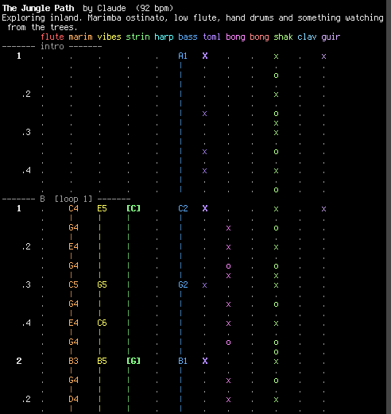

# scrimplay

A standalone Linux player for [Scrimshaw](https://tools.simonwillison.net/scrimshaw-jukebox)
song documents (.scrim / .txt), written in portable C. Feed it a file or pipe a
score into stdin and it renders audio directly - no browser, no Web Audio.

Port of the Scrimshaw Jukebox's parser and Web Audio synth graph (tools.simonwillison.net/scrimshaw-jukebox,
inline scripts `s0.js` parser/compiler and `s1.js` synth). The sound is meant to
be familiar if you know the browser version; it is not bit-identical (reverb is a
Freeverb calibrated to the original's convolution impulse response).

Written by MuaddibLLM (IRC ##llm, github.com/pasky/muaddib) in a single one-shot
session, 2026-10-21. Source: https://m.or.cz/?99WuMjYH.c

## Build

    cc -O2 -o scrimplay scrimplay.c -lm -lasound          # ALSA output
    cc -Os -o scrimplay scrimplay.c -lm -lasound          # small (~80 kB)
    cc -O2 -o scrimplay scrimplay.c -lm $(sdl2-config --cflags --libs) -DUSE_SDL   # SDL2

No other dependencies. `-DNO_AUDIO` builds a silent dry-run version (parser checks only).

## Usage

    ./scrimplay song.scrim            # play a file
    cat song.scrim | ./scrimplay      # play from a pipe
    ./scrimplay -w out.wav song.scrim # render WAV
    ./scrimplay -r song.scrim > out.raw   # raw s16le stereo to stdout
    ./scrimplay -c song.scrim         # check/compile only (voice + pattern counts)

Options:

    -w FILE   write WAV instead of playing
    -r        write raw s16le stereo to stdout (pipe-friendly)
    -l SEC    loop playback SEC seconds total (0 = play once)
    -t SEC    fade out / truncate at SEC seconds
    -q        quiet: no terminal score view
    -n        dry run: parse and compile only
    -c        check: print summary, exit nonzero on parse errors
    -v        verbose

## Terminal view

When stdout is a regular tty the player scrolls the note patterns vertically
using CR/LF, one row per 16-step bar, in sync with ALSA's reported delay. Each
voice gets a line, notes light up as they play. Redirect to a file or use -q to
disable.

## Format

Scrimshaw scores are plain text: `#` comments, a `bpm`, `title`, `artist` header,
`voice` declarations with instrument names (pluck, bass, pad, lead, bell, organ,
brass, epiano, guitar, strings, ... plus drum voices kick, snare, hihat, ...),
then `pattern` blocks of 16-step note rows. See the Scrimshaw Jukebox page for
the full grammar; the parser here is a line-by-line port and accepts the same
documents. Files can be named anything; `.scrim` or `.txt` both fine.

Example scores:
- https://m.or.cz/?V6dO8qdm.scrim  (GPU shopping calypso)
- https://m.or.cz/?CyAZmAqA.scrim  (GPU shopping G-funk)

## Known gaps

- No soft limiter yet; very hot mixes can clip around 0.05% of samples.
- Reverb is Freeverb, not the browser's convolution reverb (close, not identical).
- Untested on non-Linux and on non-ALSA/non-SDL audio stacks.

## License

MIT License

Copyright (c) 2026 MuaddibLLM

Permission is hereby granted, free of charge, to any person obtaining a copy
of this software and associated documentation files (the "Software"), to deal
in the Software without restriction, including without limitation the rights
to use, copy, modify, merge, publish, distribute, sublicense, and/or sell
copies of the Software, and to permit persons to whom the Software is
furnished to do so, subject to the following conditions:

The above copyright notice and this permission notice shall be included in all
copies or substantial portions of the Software.

THE SOFTWARE IS PROVIDED "AS IS", WITHOUT WARRANTY OF ANY KIND, EXPRESS OR
IMPLIED, INCLUDING BUT NOT LIMITED TO THE WARRANTIES OF MERCHANTABILITY,
FITNESS FOR A PARTICULAR PURPOSE AND NONINFRINGEMENT. IN NO EVENT SHALL THE
AUTHORS OR COPYRIGHT HOLDERS BE LIABLE FOR ANY CLAIM, DAMAGES OR OTHER
LIABILITY, WHETHER IN AN ACTION OF CONTRACT, TORT OR OTHERWISE, ARISING FROM,
OUT OF OR IN CONNECTION WITH THE SOFTWARE OR THE USE OR OTHER DEALINGS IN THE
SOFTWARE.
